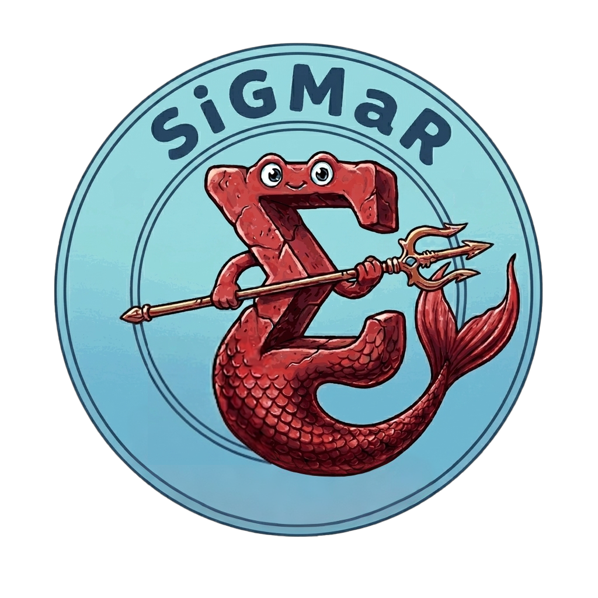

<p align="center">
  
</p>

# SiGMaR

**SiGMaR** is a local dashboard for **molecular subtyping of tumour samples** from gene expression data. You upload a counts/expression matrix and pick the tumour type. SiGMaR then runs several classification methods, combines them into a consensus subtype for each sample, and produces tables, plots and reports. If you also provide a clinical annotation file, SiGMaR can test whether the subtypes are associated with clinical variables.

SiGMaR runs entirely on your own computer inside Docker. Your data never leaves your machine. You use the app from a web browser at `http://localhost:8060`.

---

## Contents

- [Features](#features)
- [Supported tumour types](#supported-tumour-types)
- [Subtyping methods](#subtyping-methods)
- [Requirements](#requirements)
- [Installation](#installation)
- [Starting and stopping SiGMaR](#starting-and-stopping-sigmar)
- [Running an analysis](#running-an-analysis)
- [Input files](#input-files)
- [Outputs](#outputs)
- [Troubleshooting](#troubleshooting)
- [Further documentation](#further-documentation)
- [How to cite](#how-to-cite)

---

## Features

- Upload expression/counts data (`.csv`, `.tsv`, `.txt`, `.xlsx`), with automatic detection of the gene and sample ID columns
- Optional **DESeq2 normalization**, with optional batch correction
- **Multiple subtyping methods** run in one pipeline (see [below](#subtyping-methods))
- A **consensus subtype** and an **agreement score** for each sample
- Interactive results: subtype distribution, per-sample view, method comparison
- **HTML / PDF reports** and downloadable plots
- **Saved studies**: reopen any past analysis
- **Clinical Association**: test subtypes against categorical and continuous clinical variables

## Supported tumour types

| Tumour | Code |
|---|---|
| Bladder Cancer | BLCA |
| Breast Cancer | BRCA |
| Colon Adenocarcinoma | COAD |
| Glioblastoma | GBM |
| Head and Neck Squamous Cell Carcinoma | HNSCC |
| Lung Adenocarcinoma | LUAD |
| Lung Squamous Cell Carcinoma | LUSC |
| Mesothelioma | MESO |
| Ovarian Cancer | OV |
| Pancreatic Adenocarcinoma | PDAC |
| Sarcoma | SARC |

## Subtyping methods

| Method | Description | Availability |
|---|---|---|
| **Nearest Template Prediction (NTP)** | Compares each sample with tumour-specific subtype templates | All tumours |
| **Single-sample GSEA (ssGSEA)** | Scores the enrichment of subtype gene signatures in each sample | All tumours |
| **Centroid Correlation** | Compares samples with subtype centroids using Pearson correlation, cosine similarity and Euclidean distance | All tumours |
| **Tumor Molecular Pathology (TMP)** | GDAN-TMP machine-learning models (JADBio, SKGrid, AKLIMATE, SubSCOPE, CloudForest), each run in its own Docker container | Where a model exists for that tumour |
| **consensusOV** | Consensus subtype classifier for ovarian cancer | OV only |
| **CMS** | Consensus Molecular Subtypes for colorectal cancer | COAD only |
| **BreastSubtypeR (AIMS, sspbc)** | Single-sample PAM50 intrinsic subtype classifiers for breast cancer | BRCA only |

When a method does not apply to the selected tumour, the pipeline marks it **Skipped**. This is not an error.

In the final step, SiGMaR merges all available predictions. For each sample, the subtype predicted by the most methods becomes the **Final Consensus**. The **Agreement Score** is the fraction of methods that agree with it. For example, `1.0` means every method agrees. If the methods disagree completely, the sample is labelled `Uncertain`.

---

## Requirements

- **Operating system:** Windows 10/11, macOS or Linux
- **Docker:** [Docker Desktop](https://www.docker.com/products/docker-desktop/) (Windows/macOS) or Docker Engine + Docker Compose (Linux). It must be installed **and running**.
- **Browser:** any recent browser (Chrome, Firefox, Edge, Safari)

Recommended hardware:

| | Minimum | Recommended | Large datasets |
|---|---|---|---|
| CPU | 4 cores | 6–8 cores | 8+ cores |
| RAM | 8 GB | 16 GB | 32 GB+ |
| Free disk space | 30 GB | 50–70 GB | 80–100 GB |

Check how much memory Docker Desktop is allowed to use (*Settings → Resources*). We recommend at least **8 GB (ideally 12–16 GB)** and **60 GB** of disk image size. If Docker's memory limit is too low, DESeq2 and the TMP models can fail even on a computer with plenty of RAM.

---

## Installation

This repository contains the **source code only**. The ready-to-run installers
(Windows, macOS, Linux) and the full reference/example datasets are
distributed separately, since they are too large for a git repository.

> **Download the installers and data bundle here:** **[SiGMaR on Zenodo](https://zenodo.org/TODO)**
> <!-- TODO: replace with the real Zenodo DOI link once the deposit is published -->

The installer ships with the pre-built Docker images, which are about 7 GB. You do not need an internet connection or any Python/R setup to install it.

### Windows

1. Install [Docker Desktop](https://www.docker.com/products/docker-desktop/) and **start it**. Wait until its icon in the system tray shows that it is running.
2. Download `SiGMaR-Setup.exe` **and** `SiGMaR-Setup-1.bin` into the **same folder**. The installer does not work without the `.bin` file next to it.
3. Double-click `SiGMaR-Setup.exe` and follow the wizard.
4. Loading the Docker images can take several minutes. The progress text changes as it goes (for example "Loading GDAN-TMP model images (2 of 5)..."); this is normal.
5. When the installation finishes, a **SiGMaR** shortcut appears on your Desktop.

You do not need administrator rights. SiGMaR is installed for the current user in `%LOCALAPPDATA%\Programs\SiGMaR`.

**Uninstall:** use *Settings → Apps → SiGMaR → Uninstall* to remove the app only. To remove everything (app, Docker images and containers, shortcut and logs), run `uninstall_all_sigmar.bat`, which comes with the installer.

### macOS

1. Install [Docker Desktop](https://www.docker.com/products/docker-desktop/) in `/Applications/Docker.app`.
2. Download and unpack the SiGMaR macOS package.
3. Open a Terminal in the SiGMaR folder and run:

   ```bash
   chmod +x setup.sh
   ./setup.sh
   ```

   The script loads the Docker images from `bin/`, prepares the working folders and creates `SiGMaR.app` on your Desktop.

### Linux

1. Install Docker Engine and Docker Compose. Make sure the daemon is running (`docker info` must work) and that your user can run Docker commands.
2. Install the `.deb` package:

   ```bash
   sudo apt install ./sigmar_1.0_amd64.deb
   ```

For known issues (apt permission warnings, missing desktop icon, Docker group permissions), see [TROUBLESHOOTING.md → Linux](TROUBLESHOOTING.md#linux).

---

## Starting and stopping SiGMaR

**Start:** double-click the **SiGMaR** shortcut (Windows/Linux) or **SiGMaR.app** (macOS). The launcher:

1. checks that Docker is running (on macOS it starts Docker Desktop if needed);
2. starts the SiGMaR container;
3. opens your browser at **http://localhost:8060**.

If the browser does not open by itself, go to `http://localhost:8060` manually. On Windows, if a message says that Docker Desktop is not running, open Docker Desktop and launch the shortcut again.

**Stop:** from a terminal in the SiGMaR folder, run:

```bash
docker compose down
```

---

## Running an analysis

A small example dataset is available in [`test_data/`](test_data/) (`dummy_counts.csv`, `dummy_clinical.csv`) if you want to try the app.

### 1. Upload

Open **Subtyping** from the Home page.

1. **Output Location:** enter a run name (for example `brca_run_01`) and click **Confirm Output Location**. Results are saved in `uploads/results/<run_name>/`.
2. **Biological Context:** select the tumour type. This choice determines which centroids, signatures and TMP models are used.
3. **Load Data:** upload the **counts file** (required) and, if you have one, the **clinical file**. Check that the detected **Gene column** and **Sample ID column** are correct.
4. Click **Next → Subtyping**.

### 2. Analysis

1. **DESeq2 Normalization** (optional, recommended for raw counts). If needed, turn on *Enable Batch Correction* and pick the batch column. Then click **Run Normalization**. If you run it, all methods use the normalized matrix.
2. **Prediction Pipeline:** click **Run Subtyping**. Each method shows its status: running, done, failed or *Skipped*.
3. When the pipeline finishes, click **Go to Results**.

### 3. Results

- A table with each sample's predictions from every method, the **Final Consensus** and the **Agreement Score**
- Plots of the subtype distribution, a per-sample view and a method comparison
- **HTML / PDF report** export

To reopen a previous analysis, use **Saved Studies**.

### 4. Clinical Association (optional)

This requires a completed analysis and a clinical file whose sample IDs match the counts file.

1. Open **Clinical Association** and select a study.
2. Choose one or more clinical variables.
3. Set the **Agreement threshold** (default 70%). Only samples whose consensus is at least this robust are used. To use every sample, turn on **Use all samples**.
4. Click **Run Clinical Association**.

SiGMaR detects whether each variable is categorical (for example response, sex or stage) or continuous (for example age or a biomarker score). It then produces subtype-by-category comparisons or per-subtype distributions with descriptive statistics.

---

## Input files

### Counts file (required)

The file must have one column of gene identifiers and one numeric column per sample:

```text
Gene,Sample_01,Sample_02,Sample_03
TP53,120,98,130
EGFR,45,60,58
MYC,300,280,310
```

### Clinical file (optional)

The file must have one column of sample IDs, matching the counts file column names, and one or more clinical variables:

```text
Sample,age,response,batch
Sample_01,62,Responder,A
Sample_02,55,Non-responder,B
Sample_03,70,Responder,A
```

Accepted formats for both files: `.csv`, `.tsv`, `.txt`, `.xlsx`.

---

## Outputs

Each run writes its results to `uploads/results/<run_name>/`:

| File / folder | Content |
|---|---|
| `counts.csv`, `annotation.csv` | Standardized copies of the uploaded files |
| `norm_data.csv` | DESeq2-normalized counts, if you ran normalization |
| `NTP/`, `ssGSEA/`, `Centroid_Correlation/`, `TMP/`, `CMS/`, `Consensus_OV/` | Results of each method |
| `final_complete_summary.txt` | One row per sample with every method's prediction and the consensus, ready for R, Python or Excel |
| `dashboard_data.json` | Data behind the Results dashboard |
| `report.html` | Summary report |
| `clinical_association/`, `clinical_association_report.html` | Clinical Association results, if you ran it |
| `TMP/tmp_run.log` | Detailed log of the TMP models |

Keep the whole `uploads/results/<run_name>/` folder. SiGMaR needs everything in it to reopen the study later.

---

## Troubleshooting

| Problem | What to check |
|---|---|
| The app does not open | Make sure Docker Desktop is running. Launcher logs are in `%LOCALAPPDATA%\SiGMaR\launcher.log` (Windows) and `~/Library/Logs/SiGMaR/launcher.log` (macOS). |
| **Next** stays disabled | Check that you have entered a run name, selected a tumour type, uploaded a valid counts file and picked the correct gene column. |
| A method shows *Skipped* | This is usually expected: the method is not available for the selected tumour. |
| TMP fails | See `uploads/results/<run_name>/TMP/tmp_run.log`, and check that Docker has enough memory. |
| Clinical Association shows no variables | Check that you uploaded a clinical file, selected the correct sample ID column, and that the sample IDs match the counts file. |

For installation and startup issues specific to your operating system (Docker/WSL2 setup, permission errors, antivirus/Gatekeeper blocks, port conflicts, and more), see **[TROUBLESHOOTING.md](TROUBLESHOOTING.md)**: [macOS](TROUBLESHOOTING.md#macos) · [Windows](TROUBLESHOOTING.md#windows) · [Linux](TROUBLESHOOTING.md#linux).

---

## Further documentation

- [docs/Installation_Guide_SiGMaR.pdf](docs/Installation_Guide_SiGMaR.pdf): installation guide (English)
- [docs/SiGMaR_Overview_and_Test_Guide.pdf](docs/SiGMaR_Overview_and_Test_Guide.pdf): overview and test guide
- [TROUBLESHOOTING.md](TROUBLESHOOTING.md): installation and startup issues for macOS, Windows and Linux, plus a Docker installation appendix

## How to cite

The citation will be added once the paper is published.
<!-- TODO: add the reference / DOI -->

## License

SiGMaR is released under the [GNU General Public License v3.0](LICENSE).

This repository vendors a third-party package, `vendor/CMSclassifier`
(GPL-licensed, see [its NOTICE](vendor/CMSclassifier/NOTICE.md) for
provenance — the original upstream repository is no longer available).
